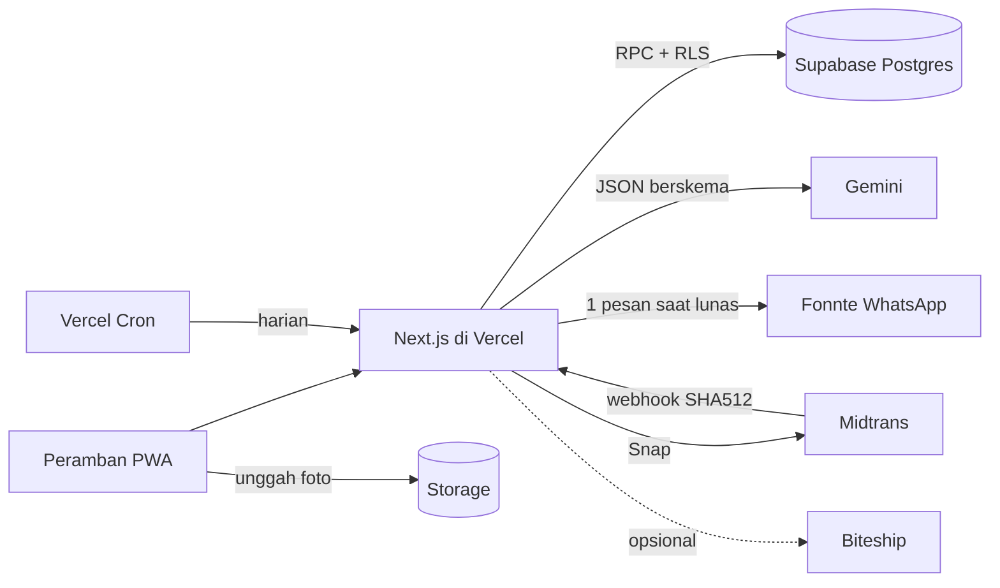
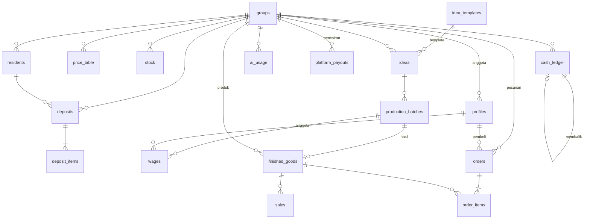
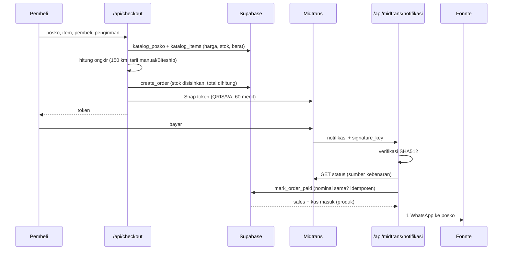

# SDD: Software Design Document

Produk: KriyaPKK
Versi: 1.1 (dokumen baru di rangkaian 2.x; diverifikasi ulang 10 November 2026)
Dasar: kode commit `aa876a4` (1 November 2026), cabang `main`
Dokumen terkait: SRS 2.1 (kebutuhan), FRD 2.1 (fungsi), PRD 2.1, BRD 2.1

Dokumen ini menjelaskan **bagaimana** sistem dibangun. Disusun dari pembacaan kode, bukan dari rencana. Bagian yang tidak dapat diaudit karena berkas hilang diberi tanda **[0002 hilang]**.

## 1. Gambaran arsitektur

Satu aplikasi Next.js 16 (monolit) di Vercel, dengan Supabase sebagai basis data, autentikasi, dan penyimpanan. Logika yang mengubah uang, stok, kas, dan pesanan berada di **fungsi Postgres**, bukan di kode aplikasi.

```text
Peramban (PWA)
   |  Server Components - Server Actions - Route Handlers (Vercel)
   |  proxy.ts: sesi Supabase + penjaga halaman
   |
   +-- /api/scan, /api/ideas, /api/guide ---> Gemini (JSON berskema, cache, kuota)
   +-- /api/ongkir -------------------------> tarif manual (atau Biteship)
   +-- /api/checkout, /api/pesanan/bayar ---> Midtrans Snap
   +-- /api/midtrans/notifikasi <------------ webhook Midtrans (SHA512)
   |         +--> Fonnte: 1 WhatsApp ke posko saat lunas
   +-- /api/keepalive <---------------------- Vercel Cron harian
   +-- Supabase
         +-- Auth (email + kata sandi; admin, pengurus, anggota, pembeli)
         +-- Postgres + RLS per kelompok dan per pembeli
         |     +-- RPC atomik: setoran, produksi, upah, penjualan, pesanan, pencairan
         +-- Storage: photos (privat), produk (publik)
```



## 2. Struktur modul

| Lokasi | Tanggung jawab |
|---|---|
| `src/app/(app)/` | Halaman setelah login (posko dan admin): beranda, setoran, warga, stok, ide, produksi, produk, pesanan, kas, laporan, anggota, pengaturan, upah, menu, admin, admin/pencairan |
| `src/app/(toko)/` | Toko online: katalog, keranjang, checkout, akun/pesanan, privasi, lacak (dialihkan) |
| `src/app/api/` | 11 route: scan, ideas, guide, export/kas, keepalive, ongkir, checkout, pesanan/bayar, pesanan/simulasi, midtrans/notifikasi, diagnosa |
| `src/app/login`, `daftar`, `daftar/pembeli`, `status`, `page.tsx`, `manifest.ts` | Autentikasi, pendaftaran, halaman status aktivasi, landing, PWA |
| `src/proxy.ts`, `lib/supabase/proxy.ts` | Penyegaran sesi dan penjaga halaman (pengganti `middleware.ts` di Next.js 16) |
| `src/lib/auth.ts` | `getMe`, `requireMe`, `requirePembeli` |
| `src/lib/actions/` | Server Actions: auth, ops (harga, pengaturan, ide, produksi, upah, penjualan, kas, toko, produk, status pesanan, rekening), admin (pencairan) |
| `src/lib/ai/` | `gemini.ts` (klien, model utama dan cadangan, timeout), `schemas.ts` (skema Zod dan JSON Schema, system prompt), `usage.ts` (cache, kuota) |
| `src/lib/marketplace/` | Ongkir (`ongkir.ts`, `ongkir-manual.ts`, `biteship.ts`), Midtrans (`midtrans.ts`, `snap.ts`, `midtrans-mode.ts`), pesanan (`pesanan.ts`, `status.ts`), Fonnte (`fonnte.ts`, `wa.ts`), geografi (`geo.ts`), keranjang, simulasi |
| `src/lib/calc.ts` | Pratinjau perhitungan di layar (angka resmi dari database) |
| `supabase/migrations/` | `0001` skema inti; `0003` ukuran kemasan; `0004_akun_pembeli` pembeli, resi, pencairan. `0002_marketplace` **hilang**; `0004_kelengkapan_toko` dibatalkan |
| `supabase/tests/` | Uji database di Postgres lokal |

## 3. Keputusan desain

| No | Keputusan | Alasan | Konsekuensi |
|---|---|---|---|
| D1 | Logika uang, stok, kas, dan pesanan di fungsi Postgres `security definer` | Atomik dan tidak bisa diakali klien | Sulit diuji dan diberi versi; skema dan logika harus dikelola bersama |
| D2 | AI hanya mengenali jenis dan kondisi; harga dari tabel | Konsisten, adil, hemat token | Berat harus diketik pengurus |
| D3 | Harga, ongkir, dan total dihitung ulang di server | Browser tidak dipercaya | Pembeli dapat melihat total berbeda bila tarif berubah |
| D4 | RLS per `group_id` dan per `buyer_id`; hak akses tabel dicabut lalu dibuka per kolom | Isolasi data antar posko | Tiap tabel baru wajib kebijakan dan grant |
| D5 | Cache AI global (tanpa `group_id`) | Hasil tidak mengandung data pribadi; hemat panggilan | Cache dapat dibaca semua anggota aktif |
| D6 | Kuota AI per kelompok per hari dengan kunci advisory | Mengendalikan biaya | Panduan memakai kuota ide |
| D7 | Buku kas append-only dengan entri pembalik | Auditabilitas | Koreksi menambah baris |
| D8 | Ongkir manual dengan matriks tarif di kode; Biteship opsional | Tanpa langganan API | Tarif tidak dapat diubah pengurus; perubahan butuh rilis |
| D9 | Midtrans Snap dengan status dicek ulang ke API dan nominal wajib sama | Webhook tidak dapat dipalsukan | Perlu kunci server yang benar dan URL notifikasi terdaftar |
| D10 | Dana online masuk ke rekening platform; pencairan dicatat manual | Tanpa verifikasi bisnis untuk split pembayaran | Tidak ada komisi otomatis |
| D11 | `finished_goods` dipakai sebagai produk jadi dan barang katalog | Satu sumber stok | Kolom katalog (kategori, berat, ukuran, tampil) ada di tabel yang sama |
| D12 | Keranjang di `localStorage` | Tanpa tabel keranjang | Tidak lintas perangkat |
| D13 | Cron harian `keepalive` | Mencegah Supabase gratis dijeda | Satu panggilan per hari |
| D14 | Simulasi pembayaran hanya di sandbox | Uji tanpa Midtrans aktif | Harus dimatikan sebelum produksi |

## 4. Model data

### 4.1 Diagram



### 4.2 Tabel dan kolom penting

| Tabel | Kolom penting dan aturan |
|---|---|
| `groups` | `status` (pending, active, inactive), `wage_per_hour` (12.500), `default_margin` (0,40; 0 sampai 3), `quota_scan_daily` (30), `quota_idea_daily` (10). Profil toko **[0002 hilang]**: `slug`, `whatsapp`, `city`, `postal_code`, `latitude`, `longitude`, `shop_open`. Rekening (0004): `bank_name`, `bank_account_no` (5 sampai 20 digit), `bank_account_name` |
| `profiles` | `role` (admin, pengurus, anggota, pembeli), `group_id` (kosong untuk pembeli), `is_active`, `phone`, `privacy_consent_at` |
| `residents` | `balance` tidak negatif |
| `price_table` | Unik (`group_id`, `item_type`); `price_per_kg` lebih dari 0 |
| `deposits` | `status` (draft, approved, cancelled), `total`, `paid_cash`, `photo_path`, `photo_hash`, `ai_result` |
| `deposit_items` | `condition` (bersih, kotor, rusak), `is_eligible`, `ai_suggested`, `weight_kg` lebih dari 0, `price_per_kg` (salinan), `subtotal` |
| `stock` | Unik (`group_id`, `item_type`); `qty_kg` tidak negatif; `avg_value_per_kg` |
| `ideas` | `materials`, `tools`, `extras` (JSON); `material_cost`, `extra_cost`, `tool_cost`, `labor_cost`, `unit_cost`, `margin`, `sell_price`; `guide`; `source` (ai, template, manual); `stock_hash` |
| `production_batches` | `status` (running, done, cancelled); `materials_used`; `qty_planned`, `qty_done`, `qty_failed`; `assigned_members` |
| `finished_goods` | `qty`, `unit_cost`, `sell_price`; katalog **[0002 hilang]**: `category` (kuliner, kerajinan, pupuk, kebersihan), `description`, `waste_materials`, `weight_grams`, `is_listed`; ukuran (0003): `length_cm`, `width_cm`, `height_cm` (1 sampai 300) |
| `sales` | `unit_price`, `unit_cost` (salinan saat terjual), `total`, `buyer_name`, `sold_at` |
| `cash_ledger` | `entry_type` (in, out); `category` (modal_awal, pembelian_setoran, bahan_tambahan, upah, penjualan, lainnya, koreksi); `reverses_id` unik |
| `ai_usage` | `fn` (scan, idea, guide), `model`, token masuk dan keluar, `ok`, `usage_date` |
| `ai_cache` | Kunci `hash` (`scan:v1:<sha256 foto>`, `idea:v1:<sha256 ringkasan stok>`, `guide:v1:<sha256 judul+bahan>`), `result` JSON |
| `orders` **[0002 hilang; kolom dirunut dari fungsi]** | `code` (`KPK-YYMMDD-XXXXXX`), `group_id`, `buyer_id`, `buyer_name`, `buyer_phone`, `buyer_email`, `shipping_method` (ambil, kurir), alamat, kota, kode pos, koordinat, `distance_km`, kurir (`courier_company`, `courier_type`, `courier_name`, `shipping_eta`), `shipping_cost`, `subtotal`, `total`, `note`, `status`, `paid_at`, `closed_at`, `stock_returned`, `payment_type`, `midtrans_token`, `midtrans_transaction_id`, `midtrans_status`, `tracking_number`, `created_at`, `updated_at` |
| `order_items` **[0002 hilang]** | `order_id`, `group_id`, `finished_good_id`, `name`, `qty`, `unit_price`, `unit_cost`, `weight_grams`, `subtotal` |
| `platform_payouts` | `amount` lebih dari 0, `fee` tidak negatif, `reference`, `note`, `paid_on` |
| `v_idea_capacity` (view, `security_invoker`) | `max_units` dan status bahan per ide |

### 4.3 Status

- Setoran: `draft` ke `approved` atau `cancelled`.
- Batch: `running` ke `done` atau `cancelled` (bahan dikembalikan).
- Pesanan: `menunggu_bayar` ke `dibayar` ke `diproses` ke `dikirim` (resi wajib) atau `siap_diambil` ke `selesai`; cabang `batal`, `kedaluwarsa`, `gagal`.
- Kelompok: `pending` ke `active` atau `inactive`.

## 5. Katalog fungsi database (RPC)

Awalan `_` = internal. "Server" = hanya `service_role`.

| Kelompok | Fungsi | Pemanggil |
|---|---|---|
| Peran | `my_group_id`, `my_any_group_id`, `my_role`, `is_admin`, `is_pengurus`, `today_wib` | login |
| Setoran | `create_deposit`, `approve_deposit`, `cancel_deposit`, `withdraw_balance` | pengurus |
| Kas | `add_cash_entry`, `reverse_cash_entry` | pengurus |
| Ide | `create_idea`, `create_idea_from_template`, `update_idea_pricing` (pengurus), `save_idea_guide` | anggota atau pengurus |
| Produksi | `start_batch`, `cancel_batch`, `pay_wages` (pengurus), `finish_batch` (pengurus atau anggota yang ditugaskan) | sesuai peran |
| Penjualan | `record_sale`, `save_product` | pengurus |
| Laporan | `report_profit_loss` (pengurus), `report_impact` (anggota) | sesuai peran |
| AI | `consume_ai_quota`, `finish_ai_usage`, `ai_quota_status` | anggota |
| Admin | `admin_list_groups`, `admin_set_group_status`, `admin_set_quota`, `admin_saldo_posko`, `admin_record_payout`, `admin_delete_payout` | admin |
| Katalog | `katalog_posko`, `katalog_items` (anon, login, server); `katalog_list`, `katalog_detail` **[0002 hilang]** | umum |
| Pesanan | `create_order`, `mark_order_paid` (server); `set_order_status`, `posko_pesanan_saya` (login); `attach_payment`, `close_order`, `set_midtrans_status`, `expire_stale_orders`, `expire_my_stale_orders` **[0002 hilang]** | sesuai peran |
| Dana | `my_platform_balance` (pengurus), `_saldo_platform` (internal) | sesuai peran |
| Internal | `_require_member`, `_require_pengurus`, `_require_admin`, `_idea_costs`, `_approve_deposit`, `_start_batch`, `_finish_batch`, `_pay_wages`, `_record_sale`, `_expire_stale_orders` | fungsi lain |
| Data demo | `demo_seed(uuid)` (0001; tanpa izin eksekusi untuk klien, dipanggil manual lewat SQL) | admin basis data |
| Pemicu | `handle_new_user` (pendaftaran: kelompok baru, akun pembeli, atau anggota), `seed_default_prices` (7 harga awal) | otomatis |

## 6. Alur desain utama

### 6.1 Setoran dengan scan AI

```mermaid
sequenceDiagram
  participant P as Pengurus
  participant W as Peramban
  participant A as /api/scan
  participant D as Supabase
  participant G as Gemini
  P->>W: Foto + pilih warga
  W->>W: Kompres 768 px JPEG 70%
  W->>D: Unggah ke bucket photos
  W->>A: path foto
  A->>D: Unduh foto (RLS Storage)
  A->>D: Cek ai_cache (hash foto)
  alt cache ada
    A-->>W: hasil (tanpa kuota)
  else belum
    A->>D: consume_ai_quota('scan')
    A->>G: foto + jenis dari tabel harga
    G-->>A: JSON (jenis, kondisi, layak, alasan)
    A->>D: finish_ai_usage + simpan cache
    A-->>W: hasil
  end
  P->>W: Koreksi + isi berat
  W->>D: create_deposit (harga dari price_table)
  P->>W: Setuju (saldo / tunai) atau batal
  W->>D: approve_deposit (stok naik; saldo naik atau kas keluar)
```

### 6.2 Dari stok sampai penjualan

Stok ke ide (`/api/ideas`, atau template) ke `create_idea` (costing di database) ke `start_batch` (stok turun, bahan tambahan jadi kas keluar) ke `finish_batch` (produk jadi naik) ke `pay_wages` (upah dan kas keluar, modal per unit diperbarui) ke `record_sale` (stok produk turun, kas masuk) atau ke pesanan online.

### 6.3 Checkout sampai lunas



### 6.4 Pengiriman dan pencairan

Pengurus memproses pesanan: `set_order_status` (resi wajib saat dikirim). Admin melihat `admin_saldo_posko`, mentransfer di luar aplikasi, lalu `admin_record_payout` (jumlah + biaya tidak boleh melebihi saldo).

## 7. Keamanan

### 7.1 Autentikasi dan otorisasi
- Supabase Auth (email dan kata sandi). `proxy.ts` mengalihkan yang belum login ke `/login`; `/api/*` memeriksa sendiri (401).
- `requireMe` memeriksa akun aktif dan kelompok aktif; pembeli hanya ke halaman toko.
- Peran dari metadata pendaftaran **tidak dipercaya**; `handle_new_user` menetapkan peran sendiri.

### 7.2 Hak akses basis data
- `revoke all` pada tabel untuk `anon` dan `authenticated`; `select` dibuka lalu dibatasi RLS; tulis hanya pada kolom tertentu lewat `grant update (kolom)`.
- Eksekusi fungsi dicabut untuk semua, lalu dibuka per fungsi. Fungsi pesanan hanya untuk `service_role`.

### 7.3 Matriks akses data

| Data | Pengurus | Anggota | Pembeli | Admin | Umum |
|---|---|---|---|---|---|
| Warga, setoran, kas, penjualan | Kelompok sendiri | Tidak | Tidak | Tidak (kecuali ringkasan) | Tidak |
| Harga, stok, ide, produksi, produk | Kelompok sendiri | Kelompok sendiri (baca) | Tidak | Tidak | Katalog produk tampil saja |
| Upah | Semua di kelompok | Milik sendiri | Tidak | Tidak | Tidak |
| Pesanan | Kelompok sendiri | Tidak | Milik sendiri | Tidak | Tidak |
| Pencairan | Kelompok sendiri (baca) | Tidak | Tidak | Semua | Tidak |
| `ai_cache` | Baca dan tulis | Baca dan tulis | Tidak | Tidak | Tidak |

### 7.4 Pembayaran dan rahasia
- Webhook: SHA512 dari `order_id + status_code + gross_amount + ServerKey`, dibandingkan secara konstan; status dicek ulang ke API Core; nominal wajib sama; notifikasi ganda idempoten.
- Kunci `GEMINI_API_KEY`, `SUPABASE_SECRET_KEY`, `MIDTRANS_SERVER_KEY`, `FONNTE_API_TOKEN`, `CRON_SECRET` hanya di server.
- `/api/keepalive` dilindungi header `Authorization: Bearer <CRON_SECRET>`. `/api/diagnosa` aktif saat pengembangan, atau di produksi lewat `?kunci=<CRON_SECRET>`.

### 7.5 Celah dan risiko yang diketahui

| Risiko | Keterangan |
|---|---|
| Tanpa pembatasan laju dan captcha | Endpoint publik (`/api/ongkir`, pendaftaran) dapat disalahgunakan; rate limit di migrasi dibatalkan tidak berlaku |
| Tanpa header keamanan | `next.config.ts` kosong (tanpa CSP) |
| Kata sandi akun demo ada di README | **Repositori GitHub ini publik** (diperiksa 10 November 2026), sehingga kata sandi terlihat siapa pun. Ganti setelah masa penjurian atau pindahkan dari README |
| Tabel pesanan tidak dapat diaudit | Migrasi `0002` hilang |
| Simulasi pembayaran | Harus dimatikan sebelum produksi (`SIMULASI_PEMBAYARAN`) |

## 8. Konfigurasi (variabel lingkungan)

| Nama | Wajib | Fungsi |
|---|---|---|
| `NEXT_PUBLIC_SUPABASE_URL`, `NEXT_PUBLIC_SUPABASE_PUBLISHABLE_KEY` | Ya | Klien Supabase |
| `SUPABASE_SECRET_KEY` | Ya | Server saja |
| `GEMINI_API_KEY`, `GEMINI_MODEL`, `GEMINI_MODEL_FALLBACK` | Ya | AI (bawaan model `gemini-3.5-flash-lite`) |
| `CRON_SECRET` | Ya | Cron dan diagnosa |
| `NEXT_PUBLIC_APP_URL` | Disarankan | Alamat aplikasi untuk tautan dan callback; bila kosong memakai alamat dari permintaan, lalu `http://localhost:3000` |
| `ONGKIR_MODE` | Tidak | `biteship` mengaktifkan Biteship; selain itu `manual` (bawaan) |
| `NEXT_PUBLIC_MIDTRANS_CLIENT_KEY`, `MIDTRANS_SERVER_KEY` | Ya | Pembayaran |
| `MIDTRANS_IS_PRODUCTION` atau `NEXT_PUBLIC_MIDTRANS_IS_PRODUCTION` | Tidak | `true` hanya untuk kunci produksi; kosong atau `false` = sandbox. Yang tanpa awalan dibaca lebih dulu, dan dibaca saat berjalan |
| `SIMULASI_PEMBAYARAN` | Tidak | Uji sandbox |
| `FONNTE_API_TOKEN` | Tidak | WhatsApp |
| `ADMIN_EMAIL` | Tidak | Kontak di halaman privasi |
| `BITESHIP_API_KEY`, `BITESHIP_COURIERS` | Bila Biteship | Ongkir API |

## 9. Ongkir: rumus

Jarak tagih D = garis lurus x 1,3, dibulatkan ke atas (minimal 1 km). Berat W = berat dikenakan dengan toleransi 0,3 kg, minimal 1 kg.

| Layanan | Rumus (Rp) | Estimasi |
|---|---|---|
| JNE REG | 8.000 + D x 50 + (W - 1) x 7.000 | 1 sampai 2 hari |
| JNE YES | 15.000 + D x 80 + (W - 1) x 10.000 | 1 hari |
| J&T EZ | 9.000 + D x 50 + (W - 1) x 7.500 | 1 sampai 2 hari |
| SiCepat REG | 8.500 + D x 50 + (W - 1) x 7.000 | 1 sampai 2 hari |
| Pos Kilat Khusus | 7.500 + D x 40 + (W - 1) x 6.500 | 1 sampai 2 hari |
| JNE JTR dan SiCepat GOKIL (kargo) | 25.000 + D x 100 + maks(0, W - 10) x 2.000 | 2 sampai 3 hari |

## 10. Penanganan galat

Fungsi database melempar kode (mis. `STOK_KURANG`, `KUOTA_HABIS`, `NOMINAL_TIDAK_SESUAI`, `DI_LUAR_JANGKAUAN`, `RESI_WAJIB`, `SALDO_TIDAK_CUKUP`, `MELEBIHI_SALDO`) yang diterjemahkan ke pesan Indonesia oleh `lib/errors.ts`. Route AI membalas `{ manual: true }` saat AI gagal atau kuota habis. Notifikasi WhatsApp tidak pernah melempar galat.

## 11. Pengujian, build, dan rilis

- Uji unit: `npx tsx --test src/lib/calc.test.ts` (3 kasus).
- Uji database di Postgres lokal (`supabase/tests/README.md`): RLS dan transaksi (23 percobaan ilegal ditolak), akun pembeli, resi, pencairan.
- Rilis: impor ke Vercel, isi env untuk Production dan Preview, redeploy tiap env berubah, daftarkan URL notifikasi Midtrans, jalankan migrasi berurutan di Supabase SQL Editor.
- Tidak ada CI.

## 12. Utang teknis dan tindak lanjut

1. Tambahkan `0002_marketplace.sql`, berkas seed, dan `.env.example` agar basis data dapat dibangun ulang.
2. Hapus atau arsipkan `0004_kelengkapan_toko.sql` dan tesnya yang dibatalkan; ubah penomoran migrasi.
3. Pembatasan laju untuk endpoint publik; header keamanan.
4. Uji integrasi dan CI; perluas uji unit.
5. Laporan akurasi scan AI dan uji kegunaan.
6. Komisi platform dan pencairan otomatis bila bisnis memerlukannya.
7. Peringatan stok; ekspor laba rugi; estimasi biaya AI di panel admin.

## Riwayat revisi

| Versi | Tanggal | Perubahan |
|---|---|---|
| 1.0 | 9 Nov 2026 | Dokumen baru dari pembacaan kode commit `aa876a4` |
| 1.1 | 10 Nov 2026 | Repositori publik (7.5); variabel lingkungan dikoreksi (8); `demo_seed` ditambah (5); akses diagnosa (7.4) |
