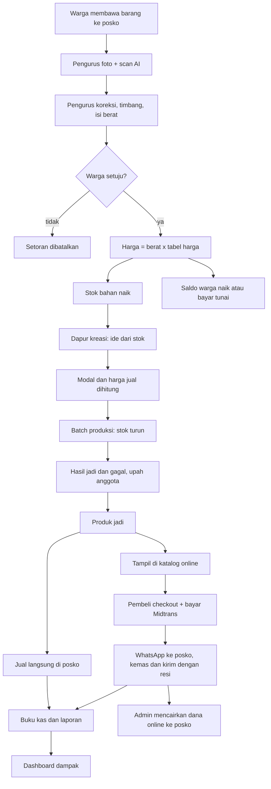
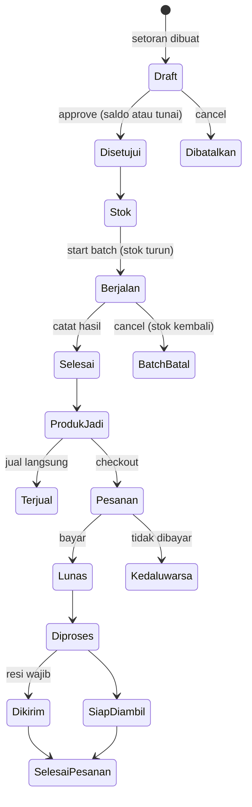

# Alur dan Cara Kerja KriyaPKK

Versi: 2.2 (diselaraskan dengan kode commit `aa876a4`, 1 November 2026, dan aplikasi live; diverifikasi dua putaran pada 10 November 2026)
Menggantikan versi awal (tersedia di riwayat git).
Karya Inovasi Perangkat Lunak, ADIKARA 2026, Fakultas Informatika Telkom University.

## 1. Peta alur tingkat tinggi

## 2. Aktor

| Aktor | Peran | Tindakan di aplikasi | Hasil |
|---|---|---|---|
| Warga penyetor | Memilah sampah | Menyerahkan barang; **tanpa akun** | Saldo tabungan atau uang tunai |
| Pengurus | Operator posko | Setoran, harga, stok, produk, pesanan, kas, anggota | Pembukuan rapi dan stok otomatis |
| Anggota perajin | Produksi | Memilih ide, mengikuti panduan, menyelesaikan batch | Upah |
| AI (Gemini) | Klasifikasi dan teks | Mengenali jenis dan kondisi; menyusun ide dan panduan | Data JSON berskema; **tidak menetapkan harga** |
| Pembeli | Konsumen | Telusuri katalog, checkout, bayar, pantau pesanan | Produk kerajinan |
| Admin platform | Pengelola | Aktivasi mitra, kuota AI, pencairan dana | Platform berjalan |

## 3. Alur tahap demi tahap

### Tahap 1: Setoran dan scan AI

1. Pengurus membuka **Setor sampah**, memilih atau membuat warga, lalu memotret barang (kamera atau galeri). Foto dikompres di peramban (768 px, JPEG 70%) dan diunggah ke penyimpanan privat.
2. Server memeriksa cache (hash foto), lalu kuota harian, lalu memanggil Gemini. AI mengembalikan per jenis barang: jenis (dari tabel harga kelompok, atau "Lainnya"), kondisi (bersih, kotor, rusak), layak atau tidak, dan alasan singkat. **AI tidak menaksir berat maupun harga.**
3. Pengurus mengoreksi bila perlu dan **mengisi berat** dari timbangan. Harga per jenis diambil dari tabel harga; subtotal = berat x harga per kg. Barang tidak layak bernilai Rp0.
4. Warga menyetujui: pengurus memilih **masuk saldo** atau **bayar tunai**, atau membatalkan.
5. Bila AI gagal atau kuota habis, aplikasi menawarkan pilih jenis manual; alur tetap berjalan.

### Tahap 2: Stok

Saat disetujui, dalam satu transaksi: stok per jenis naik dengan nilai rata-rata tertimbang, lalu salah satu dari saldo warga naik atau kas keluar (tunai). Warga dapat menarik saldo kapan saja; saat itu kas keluar.

### Tahap 3: Dapur kreasi

Pengurus atau anggota membuka **Dapur kreasi**. Sistem merangkum stok (jenis dengan stok lebih dari 0,2 kg) dan memanggil AI untuk maksimal 3 ide, atau memakai salah satu dari 13 template. Tiap ide menampilkan **berapa unit yang bisa dibuat dari stok sekarang**; ide dengan stok cukup tampil di atas, sisanya ditandai "Stok belum cukup". Hasil di-cache sehingga tidak dibuat ulang bila stok tidak berubah berarti.

### Tahap 4: Modal dan harga jual

Dihitung di database:

| Komponen | Contoh: Pouch kosmetik kain perca |
|---|---|
| Bahan dari stok (0,25 kg x Rp3.000) | Rp750 |
| Bahan tambahan (ritsleting 2.000 + benang 500) | Rp2.500 |
| Porsi alat | Rp500 |
| Upah (0,6 jam x Rp12.500) | Rp7.500 |
| **Modal per unit** | **Rp11.250** |
| Harga jual (modal x 1,40, dibulatkan ke atas Rp500) | **Rp16.000** |

Pengurus dapat mengubah bahan tambahan, margin, atau harga jual; angka lain dihitung ulang.

### Tahap 5: Produksi terpandu

1. Pengurus memulai **batch** (ide, jumlah, anggota). Stok bahan **langsung dikurangi** dan bahan tambahan dicatat sebagai kas keluar.
2. Anggota membuka panduan (persiapan, langkah, tips, keselamatan) dan dapat memakai **mode suara**. Panduan dibuat sekali saat ide dipilih lalu disimpan.
3. Hasil dicatat: jumlah jadi dan gagal (unit gagal tetap menjadi biaya). Produk jadi bertambah. Batch yang belum selesai dapat dibatalkan; bahan kembali ke stok, sedangkan kas bahan tambahan atau upah yang sudah dicatat perlu dikoreksi lewat entri pembalik.
4. Pengurus mencatat **upah** per anggota (jam dan jumlah). Upah menjadi kas keluar dan modal per unit produk diperbarui.

### Tahap 6: Penjualan

- **Langsung di posko:** pengurus mencatat penjualan (jumlah, harga, pembeli opsional). Stok produk turun, kas masuk.
- **Online:** pengurus melengkapi data produk (kategori, deskripsi, bahan limbah, berat, ukuran kemasan, foto) dan menyalakan **tampil di katalog**. Pembeli membuka katalog tanpa login, memasukkan ke keranjang, lalu masuk atau mendaftar sebagai pembeli.
  1. Pilih pengiriman: ambil di posko (gratis) atau ekspedisi (maksimal 150 km garis lurus; tarif dihitung server).
  2. Pesanan dibuat; stok disisihkan; Snap Midtrans dibuka (QRIS atau virtual account, batas bayar 60 menit).
  3. Saat lunas: penjualan dan kas masuk dicatat, dan **satu WhatsApp** dikirim ke posko.
  4. Pengurus memproses: diproses, lalu dikirim dengan **nomor resi** (atau siap diambil), lalu selesai. Pembeli melihat statusnya di **Pesanan saya** dan melacak resi di situs ekspedisi.
  5. Pesanan yang tidak dibayar kedaluwarsa dan stok kembali.

### Tahap 7: Dana online dan pelaporan

- **Dana online:** pembayaran masuk ke rekening pengelola platform. Saldo posko = pesanan lunas (produk + ongkir) dikurangi pencairan dan biaya. Admin mentransfer ke rekening posko, lalu mencatat pencairan. *Belum ada pemotongan komisi platform.*
- **Laporan:** laba rugi per periode, arus kas per kategori, ekspor CSV buku kas.
- **Dashboard dampak:** total kg dan kg per jenis, rupiah ke warga, produk dibuat dan terjual, pendapatan, laba, upah, tren bulanan.

## 4. Siklus status

## 5. Contoh kasus (aturan aplikasi)

"Dari 2,5 kg perca menjadi 10 pouch kosmetik" (template Pouch kosmetik kain perca, 0,25 kg per unit).

| Langkah | Angka |
|---|---|
| Setoran Bu Siti: 2,5 kg kain perca x Rp3.000 | Rp7.500 (masuk saldo atau tunai) |
| Stok kain perca | 2,5 kg, nilai Rp3.000 per kg; ide ini dapat dibuat **10 unit** |
| Modal per unit; harga jual | Rp11.250; Rp16.000 |
| Batch 10 unit: bahan tambahan 10 x Rp2.500 | Rp25.000 kas keluar |
| Upah 10 x Rp7.500 | Rp75.000 kas keluar |
| Jual 10 x Rp16.000 | Rp160.000 kas masuk |
| Modal terjual: (7.500 + 25.000 + porsi alat 5.000 + upah 75.000) | Rp112.500 |
| **Laba pada laporan** | **Rp47.500** |
| Kas masuk dikurangi kas keluar (bila setoran jadi saldo) | Rp160.000 - 100.000 = Rp60.000 |
| Kas bila setoran dibayar tunai | Rp52.500 |

Porsi alat Rp5.000 adalah biaya non-kas, sehingga laba laporan (Rp47.500) lebih kecil dari selisih kas. Saldo warga Rp7.500 tetap menjadi kewajiban sampai ditarik.

Dampak: 2,5 kg kain batal dibakar; warga menerima Rp7.500; perajin menerima upah Rp75.000; kas posko bertambah sesuai angka di atas.

## 6. Skenario demo singkat

1. **Scan (sekitar 1 menit):** foto kain perca, AI mengenali "Kain perca"; isi berat 2,5 kg; sistem menghitung Rp7.500 dari tabel harga. Setujui, saldo warga bertambah.
2. **Dapur kreasi (sekitar 1 menit):** buka ide dari stok, tunjukkan "10 unit" dan kartu modal: Rp750 + Rp2.500 + Rp500 + Rp7.500 = Rp11.250, harga jual Rp16.000.
3. **Produksi dan katalog (sekitar 1 menit):** mulai batch, putar panduan suara, catat hasil, tunjukkan produk di katalog dan dashboard dampak.

Untuk demo final 7 menit tambahkan: checkout pembeli (sandbox), tanda lunas dan WhatsApp ke posko, pesanan menjadi dikirim dengan resi.

## 7. Berkas terkait

- `0_BRD_v2.2.md` sampai `6_SDD_v2.2.md`: BRD, PRD, SRS, FRD, PMP, WBS, SDD (versi 2.0).
- `7_project_lengkap_v2.2.md`: konsep dan arsitektur ringkas.
- Dokumen versi 1.0 sudah dihapus dari repositori dan hanya ada di riwayat git.

## Riwayat revisi

| Versi | Tanggal | Perubahan |
|---|---|---|
| 1.0 | 25 Okt 2026 | Versi awal |
| 2.0 | 9 Nov 2026 | AI tidak menaksir harga dan berat; nama endpoint dan tabel sesuai kode; stok dipotong saat batch dimulai; upah dicatat pengurus; alur toko online dan dana online; hapus estimasi karbon dan poin sembako; contoh hitungan memakai aturan aplikasi |
| 2.1 | 10 Nov 2026 | Tautan berkas terkait dirapikan |
| 2.2 | 10 Nov 2026 | Catatan pembatalan batch dan kas |
