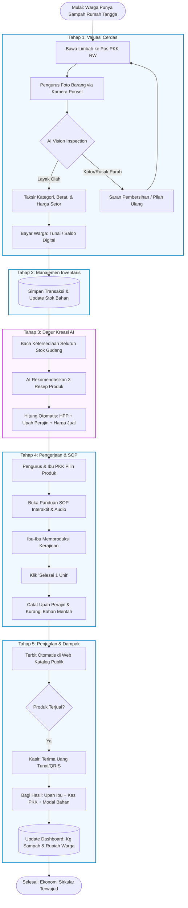
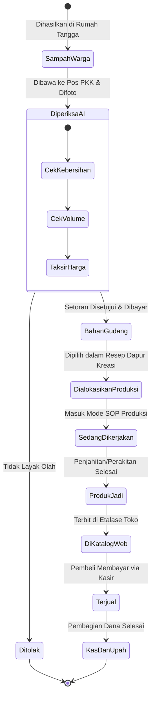

# FLOW & CARA KERJA SISTEM KRIYAPKK

**Panduan Komprehensif Alur Operasional, Interaksi Pengguna, & Logika Sistem AI**
*Karya Inovasi Perangkat Lunak – ADIKARA 2026 (Fakultas Informatika Telkom University)*

---

## 1. Peta Alur Kerja Tingkat Tinggi (*High-Level Workflow Map*)

Sistem **KriyaPKK** bekerja dengan menyambungkan 5 simpul utama rantai nilai ekonomi sirkular:

```
[1. SAMPAH RUMAH TANGGA]
           │  (Warga membawa barang sisa ke Pos RW)
           ▼
[2. SCAN & VALUASI AI] ───► AI Vision memverifikasi kelayakan & menaksir harga
           │                  Warga menerima imbalan (tunai/saldo/sembako)
           ▼
[3. INVENTARISASI GUDANG] ───► Stok bahan mentah tercatat otomatis di Supabase
           │
           ▼
[4. DAPUR KREASI AI] ───► AI membaca ketersediaan stok & merekomendasikan resep kerajinan
           │              Menghitung rincian HPP, bahan warung, & upah perajin
           ▼
[5. PRODUKSI TERPANDU (SOP)] ───► Ibu-ibu PKK memproduksi didampingi visual & audio AI
           │                      Pencatatan insentif kerja & produk jadi siap jual
           ▼
[6. ETALASE & PENJUALAN] ───► Produk terbit di katalog mini web, dipasarkan ke warga/bazar
           │
           ▼
[7. DAMPAK & KAS BERPUTAR] ───► Dashboard mencatat kg sampah terolah & keuntungan kas desa
```

---

## 2. Pemetaan Aktor & Tanggung Jawab (*Stakeholder Roles*)

| Aktor                                | Peran Utama                                   | Tindakan pada Aplikasi                                                               | Hasil yang Diterima                                                     |
| :----------------------------------- | :-------------------------------------------- | :----------------------------------------------------------------------------------- | :---------------------------------------------------------------------- |
| **Warga Penyetor**             | Memilah sampah dari rumah tangga.             | Menyerahkan sampah perca/botol/kardus ke Pos PKK.                                    | Uang tunai instan, saldo tabungan digital, atau poin sembako.           |
| **Pengurus Kasir PKK**         | Operator pos penerima setoran.                | Mengarahkan kamera ponsel untuk scan AI, konfirmasi data, dan pembukuan kas.         | Rekapitulasi transaksi rapi, stok bahan tercatat otomatis tanpa manual. |
| **Ibu-Ibu Perajin (Produksi)** | Mengolah limbah menjadi produk bernilai jual. | Memilih ide kerajinan dari aplikasi, menyimak panduan SOP, menekan tombol selesai.   | Upah kerja layak per jam/produk, keterampilan baru terasah.             |
| **Sistem AI (Vision + LLM)**   | Mesin cerdas penilai dan perencana.           | Inspeksi gambar sampah, kalkulasi HPP, kurasi ide, dan pembuatan panduan pengerjaan. | Data terstruktur (JSON) bebas halusinasi untuk antarmuka pengguna.      |
| **Pembeli / Konsumen**         | Pembeli produk jadi daur ulang.               | Mengakses tautan katalog web publik, memesan produk melalui WhatsApp.                | Produk kerajinan unik, ramah lingkungan, dan mendukung ekonomi desa.    |

---

## 3. Rincian Alur Kerja Tahap demi Tahap (*Step-by-Step Flow*)

---

### TAHAP 1: Penyetoran & Valuasi Cerdas (AI Vision Inspection)

```
[Warga datang bawa barang] ──► [Pengurus buka modul kasir] ──► [Ambil foto barang via kamera]
                                                                          │
                                                                          ▼
[Data masuk inventaris] ◄── [Konfirmasi & bayar warga] ◄── [AI deteksi jenis & taksir harga]
```

1. **Kedatangan Warga:** Warga membawa limbah anorganik bersih (kain perca konveksi, botol kaca, kardus tebal, jelantah) ke Pos PKK RW.
2. **Pengambilan Gambar:** Pengurus membuka menu **"Setor Sampah"** di KriyaPKK dan mengambil 1 foto jelas dari tumpukan barang di atas meja pos.
3. **Pemrosesan AI Vision:**
   * Citra dikirim ke endpoint `/api/vision/inspect` (Gemini 1.5 Flash Multimodal).
   * AI memeriksa 3 parameter:
     * *Material Classification:* Mengenali kategori (misal: "Kain Perca Katun").
     * *Condition Verification:* Menilai apakah kering, bersih, dan layak diproses ulang.
     * *Fair Payout Estimation:* Menghitung estimasi berat/volume dan menaksir harga tebus wajar.
4. **Pemberian Imbalan:**
   * Di layar muncul hasil: *Kain Perca Katun (±2.5 kg) – Rekomendasi Tebus: Rp 7.500*.
   * Pengurus menekan tombol hijau **"Konfirmasi Setoran"**.
   * Warga menerima uang tunai langsung atau saldo dompet digitalnya bertambah Rp 7.500.

---

### TAHAP 2: Pembukuan & Inventarisasi Otomatis (Stock Inflow)

```
[Konfirmasi Setoran] ──► [Tulis Data ke Supabase] ──► [Stok Gudang Bertambah Real-Time]
```

1. Begitu setoran dikonfirmasi, sistem otomatis mengeksekusi dua kueri basis data:
   * Mencatat baris transaksi baru di tabel `waste_deposits` (identitas penyetor, foto bukti, waktu, nominal bayar).
   * Menambahkan kuantitas bahan pada tabel `raw_materials`.
2. Pengurus tidak perlu mencatat manual di buku tulis. Status inventaris gudang langsung terbarui secara *real-time*.

---

### TAHAP 3: Dapur Kreasi AI (Ideation & Stock Matching)

```
[Buka Dapur Kreasi] ──► [Sistem agregasi stok gudang] ──► [AI filter resep dengan match rate tertinggi]
                                                                        │
                                                                        ▼
[Pilih ide terbaik] ◄── [Tampilkan 3 rekomendasi lengkap BOM] ◄─────────┘
```

1. Saat jadwal pertemuan rutin PKK, pengurus membuka modul **"Dapur Kreasi"**.
2. Sistem secara otomatis membaca saldo stok aktif:
   * *Contoh:* Tersedia 12.5 kg Kain Perca Katun dan 18 botol kaca sirup.
3. Pengurus menekan tombol **"Hasilkan Ide dari Stok"**.
4. AI menganalisis resep kerajinan yang paling masuk akal diproduksi dengan bahan tersebut dan menghasilkan **3 Rekomendasi Teratas**:
   * *Ide 1:* **Tas Pouch Make-Up Motif Batik Perca** *(Tingkat Ketersediaan Bahan: 95%)*.
   * *Ide 2:* **Tote Bag Belanja Lipat Ramah Lingkungan** *(Tingkat Ketersediaan Bahan: 90%)*.
   * *Ide 3:* **Cempal Dapur & Lap Serbaguna** *(Tingkat Ketersediaan Bahan: 100%)*.

---

### TAHAP 4: Kalkulasi Modal (BOM), HPP, & Penetapan Harga Jual

Setiap kartu ide yang dipilih langsung menyajikan rincian biaya yang transparan:

```
+───────────────────────────────────────────────────────────────────────────+
| RINCIAN BIAYA PRODUKSI (BILL OF MATERIALS) - TAS POUCH PERCA             |
+───────────────────────────────────────────────────────────────────────────+
| 1. BAHAN GUDANG POS (Gratis / Nilai Setor):                               |
|    - 200 gram Kain Perca Katun                  : Rp 1.500                |
|                                                                           |
| 2. BAHAN TAMBAHAN (Wajib dibeli di warung/toko):                          |
|    - Ritsleting 20 cm                           : Rp 2.000                |
|    - Benang Jahit & Jarum                       : Rp   500                |
|                                                                           |
| 3. UPAH JERIH PAYAH PERAJIN (Labor Cost):                                 |
|    - Estimasi pengerjaan 40 menit (@Rp 12.500/jam): Rp 8.500              |
+───────────────────────────────────────────────────────────────────────────+
| TOTAL HARGA POKOK PRODUKSI (HPP)                : Rp 12.500               |
| REKOMENDASI HARGA JUAL PASAR (Margin Kas 40%)   : Rp 20.000               |
| LABA BERSIH KAS KELOMPOK PKK (per unit)         : Rp  7.500               |
+───────────────────────────────────────────────────────────────────────────+
```

* **Keunggulan:** Ibu-ibu tidak lagi "mengira-ngira harga". Mereka tahu pasti bahwa jika barang laku Rp 20.000:
  * Rp 8.500 langsung menjadi upah jerih payah perajin.
  * Rp 4.000 untuk menutup modal bahan.
  * Rp 7.500 masuk ke kas kelompok PKK.

---

### TAHAP 5: Pengerjaan Produksi Terpandu (Guided Execution with Interactive SOP)

```
[Pilih Resep] ──► [Mode Pengerjaan Layar Penuh] ──► [Langkah 1 -> Langkah 2 -> Langkah N]
                                                                   │
                                                                   ▼
[Stok produk jadi bertambah] ◄── [Klik "Selesai 1 Unit"] ◄── [Audio panduan membacakan]
```

1. Ibu perajin mengklik tombol **"Mulai Produksi"** di ponsel atau tablet pos PKK.
2. Layar berpindah ke **Mode Pengerjaan Modular**:
   * Menampilkan gambar instruksi ukuran besar dan teks ringkas.
   * Tombol **"🔊 Dengarkan Instruksi"** mengaktifkan Text-to-Speech bahasa Indonesia agar perajin bisa fokus memotong/menjahit tanpa bolak-balik menyentuh layar.
3. Setelah satu produk selesai dirakit, perajin menekan tombol besar **"Selesai 1 Unit"**:
   * Sistem otomatis memotong stok bahan mentah di gudang.
   * Menambahkan 1 unit ke stok produk jadi.
   * Mencatat akumulasi upah jerih payah ke buku kas perajin bersangkutan.

---

### TAHAP 6: Etalase Katalog Web & Penjualan (Showcase & Distribution)

```
[Produk Jadi] ──► [Terbit Otomatis di Web Katalog] ──► [Share Link ke Grup WhatsApp Warga]
                                                                   │
                                                                   ▼
[Catat di Kasir POS] ◄── [Warga bayar tunai / QRIS] ◄── [Pembeli datang / pesan online]
```

1. Begitu produk berstatus "Selesai", produk tersebut langsung tayang di halaman **Katalog Publik KriyaPKK Desa** (tanpa perlu input ulang).
2. Pengurus cukup menyalin tautan katalog (*contoh: `kriyapkk.desa.id/pos-rw04`*) dan membagikannya ke grup WhatsApp RT/RW, bazar kelurahan, atau pameran BUMDes.
3. Saat pembeli membeli produk, pengurus membuka menu **"Kasir Penjualan"**:
   * Pilih produk yang dibeli $\rightarrow$ terima pembayaran tunai atau QRIS.
   * Sistem otomatis memisahkan uang kas: uang upah perajin dialokasikan, laba kas disimpan, dan modal bahan ditutup.

---

### TAHAP 7: Pelaporan Dampak Lingkungan & Keuangan (Impact Aggregator)

```
[Setiap Transaksi Selesai] ──► [Engine Kalkulasi Dampak] ──► [Dashboard Terbarui Real-Time]
```

Dashboard utama memperbarui 3 pilar dampak secara berkala:

1. **Dampak Ekologis:** Menghitung total kilogram limbah yang dialihkan dari pembakaran/TPA dan estimasi reduksi jejak karbon ($kg CO_2e$).
2. **Dampak Kesejahteraan Warga:** Menampilkan total rupiah yang telah dibagikan kepada warga penyetor sampah.
3. **Dampak Kemandirian Ekonomi:** Menampilkan total upah yang dinikmati ibu-ibu perajin serta saldo kas kelompok PKK.

---

## 4. Diagram Alur Proses Menyeluruh (Mermaid Flowchart)



---

## 5. Diagram Transisi Status Objek (*State Lifecycle*)

Berikut adalah siklus perubahan status material dari limbah hingga menjadi kas:



---

## 6. Skenario Simulasi Kasus Riil (*Concrete Case Walkthrough*)

Agar alur ini mudah dibayangkan, berikut adalah simulasi numerik nyata pada satu siklus produksi:

### Studi Kasus: "Dari 2.5 kg Perca Menjadi 8 Tas Pouch Kosmetik"

1. **Penyetoran:**
   * Ibu Siti menyetor 2.5 kg sisa potongan kain batik konveksi.
   * AI menaksir nilai: **Rp 7.500** (Rp 3.000/kg).
   * Ibu Siti menerima uang tunai Rp 7.500. Pos RW 04 kini memiliki stok 2.5 kg kain batik.
2. **Perumusan Ide di Dapur Kreasi:**
   * AI menyarankan pembuatan: **Pouch Make-up Perca Batik**.
   * 1 Pouch membutuhkan: 250 gram kain perca.
   * Dari 2.5 kg kain, dapat dibuat sebanyak: **10 unit pouch**.
3. **Kalkulasi Biaya per Unit Pouch:**
   * Nilai kain perca per unit ($2.5 \text{ kg} \div 10$): Rp 750.
   * Bahan warung tambahan (ritsleting + benang): Rp 2.500.
   * Upah perajin per unit (waktu pengerjaan 35 menit): **Rp 7.500**.
   * **Total HPP:** Rp 10.750.
   * **Harga Jual Rekomendasi:** **Rp 18.000**.
4. **Hasil Penjualan 10 Unit Pouch:**
   * Total Omzet Penjualan ($10 \times \text{Rp } 18.000$): **Rp 180.000**.
   * **Alokasi Dana:**
     * Upah jerih payah ibu-ibu perajin ($10 \times \text{Rp } 7.500$): **Rp 75.000** *(langsung masuk kantong ibu perajin)*.
     * Pengembalian kas modal bahan warung: Rp 25.000.
     * Pengembalian kas modal tebus sampah: Rp 7.500.
     * **Keuntungan Bersih Masuk Kas PKK:** **Rp 72.500**.
5. **Dampak yang Tercipta:**
   * 2.5 kg sampah kain batal dibakar di kebun warga.
   * Ibu Siti dapat uang belanja Rp 7.500.
   * Ibu-ibu perajin dapat tambahan nafkah Rp 75.000.
   * Kas PKK bertambah surplus Rp 72.500 untuk dana sosial warga.

---

## 7. Panduan Alur Live Demo 3 Menit (Untuk Babak Final Juri)

Jika waktu demo sangat terbatas saat babak final lomba, bawakan alur 4 langkah cepat ini:

```
+─────────────────────────────────────────────────────────────────────────+
|               SKENARIO DEMO KILAT 3 MENIT DI HADAPAN JURI               |
+─────────────────────────────────────────────────────────────────────────+
| MENIT 1: SCAN SAMPAH                                                    |
| Pegang kain perca di panggung -> Arahkan kamera -> Klik 'Taksir AI'     |
| Tunjukkan layar: "Terdeteksi Kain Perca Katun - Taksiran Rp 7.500"     |
+─────────────────────────────────────────────────────────────────────────+
| MENIT 2: DAPUR KREASI & HPP OTOMATIS                                    |
| Klik tombol 'Hasilkan Ide Kerajinan' -> Muncul resep Tas Pouch.         |
| Tunjukkan kartu HPP: Bahan limbah Rp 750, Beli ritsleting Rp 2.500,     |
| Upah Ibu Rp 7.500 -> HPP Rp 10.750 -> Jual Rp 18.000.                   |
+─────────────────────────────────────────────────────────────────────────+
| MENIT 3: MODE PRODUKSI AUDIO & KATALOG                                  |
| Klik 'Mulai Produksi' -> Bunyikan suara Audio SOP pengerjaan.           |
| Klik 'Selesai 1 Unit' -> Buka halaman web Katalog: Produk sudah tayang! |
| Tunjukkan grafik dashboard: 2.5 kg limbah terolah, Rp 75k upah warga.   |
+─────────────────────────────────────────────────────────────────────────+
```

---

## 8. Dokumen Terkait

* [project_lengkap.md](project_lengkap.md): arsitektur menyeluruh dan solusi.
* [concept_draft.md](concept_draft.md): draft ide awal.
* [Spesifikasi software](../spesifikasi/): BRD, PRD, SRS, FRD, PMP, WBS.
