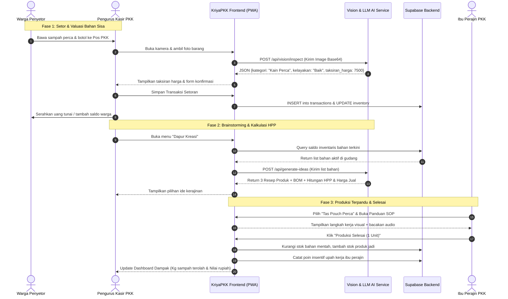

# DOKUMEN SPESIFIKASI LENGKAP & PROPOSAL INOVASI PERANGKAT LUNAK: KriyaPKK

**KriyaPKK: Sistem Manajemen Usaha Kerajinan & Olahan Limbah Berbasis AI Vision dan Mini-ERP Komunitas Desa***Karya Rekayasa Perangkat Lunak Inovatif – ADIKARA 2026**Fakultas Informatika – Universitas Telkom Bandung*

> **Sub-Tema ADIKARA:** *“Shaping a Resilient Future through Digital Transformation”*
> **Kategori:** Divisi Inovasi – Subdivisi Software Development (Penyisihan Menuju Final Onsite Telkom University)
> **Fokus Dampak:** **SDG 8** (Pekerjaan Layak & Pertumbuhan Ekonomi), **SDG 11** (Kota & Permukiman Berkelanjutan), **SDG 9** (Inovasi Industri), **SDG 4** (Pendidikan Berkualitas), serta **Asta Cita Poin 6, 2, dan 4**.

---

## DAFTAR ISI

1. [Ringkasan Eksekutif &amp; Identitas Proyek](#1-ringkasan-eksekutif--identitas-proyek)
2. [Penyelarasan Agenda Global (SDGs) &amp; Nasional (Asta Cita)](#2-penyelarasan-agenda-global-sdgs--nasional-asta-cita)
3. [Analisis Masalah &amp; Sistem Berjalan (AS-IS Analysis)](#3-analisis-masalah--sistem-berjalan-as-is-analysis)
   - 3.1 Realitas Empiris di Tingkat Akar Rumput (Desa/Kampung)
   - 3.2 5 Celah Kritis Sistem Eksisting (*Pain Points*)
4. [Perancangan Sistem Solusi Baru (TO-BE System Architecture)](#4-perancangan-sistem-solusi-baru-to-be-system-architecture)
   - 4.1 Nilai Kebaruan (*Novelty*) & *Unique Value Proposition (UVP)*
   - 4.2 Formula Otomasi HPP (*Costing & Pricing Engine*)
5. [Aktor Sistem &amp; Alur Kerja End-to-End (Workflows)](#5-aktor-sistem--alur-kerja-end-to-end-workflows)
   - 5.1 Alur 1: Penyetoran & Valuasi Cerdas (AI Vision Inspection)
   - 5.2 Alur 2: Manajemen Inventaris & Generator Ide Produksi
   - 5.3 Alur 3: Kalkulasi Modal (BOM) & Taksiran Harga Jual
   - 5.4 Alur 4: Panduan Interaktif Produksi (Step-by-Step SOP)
   - 5.5 Alur 5: Katalog Penjualan & Dashboard Dampak
6. [Diagram Alur Proses Bisnis (Mermaid Sequence Diagram)](#6-diagram-alur-proses-bisnis-mermaid-sequence-diagram)
7. [Spesifikasi Arsitektur Perangkat Lunak &amp; Teknologi](#7-spesifikasi-arsitektur-perangkat-lunak--teknologi)
   - 7.1 Tech Stack Pilihan (High Reliability & Rapid Prototyping)
   - 7.2 Skema Data (Database Schema / ERD Ringkas)
   - 7.3 Rekayasa Prompt & Skema JSON AI (*Structured Output*)
8. [Rancangan Antarmuka Pengguna (*Grassroot Zero-Friction UI/UX*)](#8-rancangan-antarmuka-pengguna-grassroot-zero-friction-uiux)
9. [Model Keberlanjutan &amp; Kelayakan Bisnis](#9-model-keberlanjutan--kelayakan-bisnis)
10. [Metrik Dampak Terukur (*Impact Metrics*)](#10-metrik-dampak-terukur-impact-metrics)
11. [Panduan Strategi Live Demo 7 Menit (Babak Final Onsite)](#11-panduan-strategi-live-demo-7-menit-babak-final-onsite)

---

## 1. Ringkasan Eksekutif & Identitas Proyek

**KriyaPKK** adalah aplikasi web progresif (*Progressive Web App - PWA*) yang memadukan sistem kasir (*Point of Sale - POS*) dan sistem perencanaan sumber daya mikro (*Mini Enterprise Resource Planning - ERP*) yang diperkuat oleh kecerdasan buatan (*Vision AI & Generative AI*) untuk mentransformasi limbah rumah tangga pedesaan menjadi produk kerajinan dan olahan pangan bernilai ekonomi tinggi yang dikelola oleh kelompok Pemberdayaan Kesejahteraan Keluarga (PKK).

Berbeda dari aplikasi bank sampah konvensional yang hanya mencatat setoran timbangan dan menumpuk sampah di gudang, KriyaPKK **mengamankan seluruh rantai nilai sirkular (*end-to-end circular supply chain*)**:

1. Menaksir kelayakan fisik dan harga limbah secara adil menggunakan kamera ponsel dan Vision AI.
2. Mengotomasi pembukuan stok bahan baku di gudang kelompok.
3. Menghasilkan rekomendasi ide kerajinan/olahan siap jual berdasarkan ketersediaan bahan riil.
4. Menghitung Harga Pokok Penjualan (HPP), upah tenaga kerja ibu-ibu, dan harga jual wajar.
5. Menyediakan panduan langkah kerja produksi visual dan audio yang mudah dipahami warga.

```
+----------------------------------------------------------------------------------------------------+
|                                    TRANSFORMASI NILAI KRIYAPKK                                     |
+--------------------------+--------------------------+----------------------------------------------+
| 1. SAMPAH WARGA          | 2. KRIYAPKK (AI CORE)    | 3. NILAI EKONOMI DESA                        |
| Botol, kardus, perca,    | Valuasi adil, stok mini, | Kerajinan berkualitas, upah  |
| jelantah, sisa pangan    | ide kreasi, hitung modal | ibu PKK, kas desa bertambah, |
| dijemput dari sumbernya. | & panduan pengerjaan.    | kampung bersih tanpa sampah. |
+--------------------------+--------------------------+----------------------------------------------+
```

---

## 2. Penyelarasan Agenda Global (SDGs) & Nasional (Asta Cita)

Karya ini dirancang secara terukur untuk menjawab agenda prioritas yang diwajibkan dalam pedoman ADIKARA 2026:

### 2.1 Target Sustainable Development Goals (SDGs):

* **SDG 8 (Pekerjaan Layak & Pertumbuhan Ekonomi - Fokus Utama):** Membuka lapangan kerja produktif baru bagi kaum perempuan di pedesaan, memberikan upah kerja layak per jam/produk, serta menumbuhkan unit usaha mikro berbasis RT/RW.
* **SDG 11 (Kota & Permukiman Berkelanjutan):** Memotong volume timbulan sampah pedesaan hingga ke tingkat hulu (rumah tangga), mengeliminasi kebiasaan membakar sampah yang mencemari udara kampung.
* **SDG 9 (Industri, Inovasi, & Infrastruktur):** Demokratisasi teknologi kecerdasan buatan (*Computer Vision & LLM*) agar dapat diakses dan dimanfaatkan oleh kelompok masyarakat desa yang selama ini terpinggirkan dari transformasi digital.
* **SDG 4 (Pendidikan Berkualitas):** Modul panduan pengerjaan terstruktur berfungsi sebagai instrumen vokasi dan pelatihan keterampilan (*lifelong micro-skill learning*) mandiri bagi ibu-ibu rumah tangga.
* **SDG 3 (Kesehatan & Kesejahteraan):** Mengurangi risiko penyakit pernapasan akibat asap pembakaran sampah dan memanfaatkan sisa pangan segar menjadi olahan bernutrisi atau kompos higienis.

### 2.2 Program Strategis Nasional (Asta Cita):

* **Asta Cita Poin 6:** Membangun dari desa dan dari bawah untuk pemerataan ekonomi dan pengentasan kemiskinan masyarakat.
* **Asta Cita Poin 2:** Memperkokoh kemandirian bangsa dan mendorong ekonomi hijau (*green & circular economy*).
* **Asta Cita Poin 4:** Memperkuat pembangunan SDM, sains, teknologi, dan keahlian vokasional perempuan pedesaan.

---

## 3. Analisis Masalah & Sistem Berjalan (AS-IS Analysis)

### 3.1 Realitas Empiris di Tingkat Akar Rumput

Di sebagian besar pedesaan dan pemukiman suburban di Indonesia, pola penanganan sampah padat rumah tangga masih bertumpu pada paradigma lama: **Kumpul – Angkut – Buang (ke TPA)** atau **Bakar di Pekarangan**.

Kelompok PKK (Pemberdayaan Kesejahteraan Keluarga) di setiap RW/Dusun sesungguhnya memiliki potensi sosial yang luar biasa: struktur kepengurusan yang solid, jadwal pertemuan rutin (arisan/pengajian), dan waktu luang produktif. Namun, program daur ulang limbah PKK hampir selalu mati suri setelah beberapa minggu berjalan karena kendala manajerial dan teknis.

### 3.2 Pemetaan 5 Celah Kritis Sistem Berjalan (*Pain Points*)

```
+----------------------------------------------------------------------------------------------------+
|                               5 CELAH KRITIS SISTEM PENGELOLAAN SAAT INI                           |
+--------------------------+--------------------------+----------------------------------------------+
| 1. BANK SAMPAH PASIF     | 2. KEBUNTUAN KREATIVITAS | 3. BLIND SPOT MODAL & HPP                    |
| Hanya kumpul & timbang,  | Bingung mau buat apa     | Tidak tahu harga pokok, upah |
| menumpuk tunggu pengepul.| dari tumpukan limbah ada.| tak dihitung, rugi di bahan. |
+--------------------------+--------------------------+----------------------------------------------+
| 4. VALUASI SUBJEKTIF                                | 5. KETIADAAN STANDAR KERJA (SOP)             |
| Warga merasa dihargai terlalu murah/tidak adil      | Hasil karya tidak seragam, kerapian rendah,  |
| sehingga berhenti menyetor sampah pilahan.          | sulit bersaing di pasar komersial.           |
+-----------------------------------------------------+----------------------------------------------+
```

1. **Paradigma Pasif Bank Sampah Konvensional (*The Dead-End Storage Dilemma*):**
   * *Masalah:* Aplikasi bank sampah yang ada (seperti Duitin, Mountrash, dsb.) hanya fokus pada pencatatan setoran timbangan botol/kardus untuk kemudian dijual ke pengepul/lapak rongsok.
   * *Kelemahan:* Nilai tambah ekonomi sangat kecil (hanya Rp 1.500–Rp 3.000/kg). Jika pengepul tidak datang, sampah menumpuk dan menjadi sarang penyakit di balai RW.
2. **Kebuntuan Ide Produksi (*Creative Paralysis*):**
   * *Masalah:* Pengurus PKK memiliki kemauan tinggi, tetapi bingung mencocokkan bahan yang tersedia di gudang dengan ide kerajinan yang relevan.
   * *Kelemahan:* Akhirnya hanya membuat kerajinan klise (misal: bunga plastik dari sedotan) yang tidak memiliki nilai fungsi dan tidak laku dijual.
3. **Buta Finansial & Kegagalan Menghitung HPP (*Financial Blind Spot*):**
   * *Masalah:* Ibu-ibu tidak mencatat biaya pembelian lem tembak, benang, ritsleting, dan mengabaikan upah lelah tenaga kerja mereka sendiri.
   * *Kelemahan:* Barang dijual dengan harga tebakan (asal murah). Ketika uang kas dihitung, saldo kas kelompok justru tekor karena biaya bahan pembantu lebih mahal dari harga jual produk.
4. **Valuasi Setoran Sampah Tidak Transparan & Subjektif:**
   * *Masalah:* Penentuan harga barang sisa warga hanya dikira-kira oleh pengurus yang berjaga.
   * *Kelemahan:* Warga merasa setorannya tidak dihargai adil, sehingga motivasi untuk memilah sampah dari rumah tangga hilang.
5. **Ketiadaan Panduan Kerja Terstandar (No Quality Assurance):**
   * *Masalah:* Anggota PKK memiliki tingkat keahlian yang berbeda-beda tanpa adanya modul instruksi yang runut.
   * *Kelemahan:* Produk yang dihasilkan tidak rapi, ukuran melenceng, dan tidak layak masuk ke etalase toko oleh-oleh atau marketplace.

---

## 4. Perancangan Sistem Solusi Baru (TO-BE System Architecture)

### 4.1 Nilai Kebaruan (*Novelty*) & Unique Value Proposition (UVP)

**KriyaPKK** menghadirkan intervensi digital cerdas yang menutup seluruh celah sistem AS-IS melalui:

* **Computer Vision Grading Engine:** Pengurus cukup memotret tumpukan kain perca atau botol. Model AI memverifikasi kebersihan, menghitung volume taksiran, dan mengembalikan taksiran harga setoran instan yang adil berdasarkan standar pasar daur ulang lokal.
* **Context-Aware Recipe Generator:** Sistem membaca seluruh saldo inventaris bahan baku di database, lalu merekomendasikan resep kerajinan yang rasio kecocokan bahannya (*stock match rate*) paling tinggi.
* **Automated BOM (Bill of Materials) & Labor Pricing Engine:** AI secara otomatis memecah bahan menjadi: *(a) Bahan Limbah Gratis/Tersedia di Gudang*, *(b) Bahan Tambahan yang Wajib Dibeli di Warung Tetangga*, dan *(c) Alokasi Biaya Tenaga Kerja (Labor Fee)*.

### 4.2 Formula Otomasi HPP (*Costing & Pricing Logic*)

Sistem menghitung biaya produksi secara matematis dengan formula terstandar akuntansi UMKM:

$$
\text{HPP Total} = C_{\text{limbah}} + C_{\text{tambahan}} + \left( T_{\text{kerja (jam)}} \times U_{\text{layak/jam}} \right) + C_{\text{overhead (listrik/alat)}}
$$

$$
\text{Harga Jual Rekomendasi (HJR)} = \text{HPP Total} \times (1 + M_{\text{margin kas PKK}})
$$

*Keterangan parameter default sistem:*

* $C_{\text{limbah}}$: Nilai kompensasi yang telah dibayarkan kepada warga penyetor.
* $C_{\text{tambahan}}$: Estimasi harga pasar bahan penunjang (misal: furing tas, resleting, lem tembak).
* $U_{\text{layak/jam}}$: Standar upah jerih payah ibu pengerja (default: Rp 12.500/jam kerja).
* $M_{\text{margin}}$: Margin kas kelompok PKK untuk kas sosial/operasional (default: 20%–30%).

---

## 5. Aktor Sistem & Alur Kerja End-to-End (Workflows)

```
+----------------------------------------------------------------------------------------------------+
|                                      AKTOR SISTEM KRIYAPKK                                         |
+--------------------------+--------------------------+----------------------------------------------+
| 1. WARGA PENYETOR        | 2. PENGURUS KASIR PKK    | 3. IBU-IBU PRODUKSI (PENGRAJIN)              |
| Menyetor sampah terpilah | Menilai fisik via AI,    | Memilih ide, menyimak panduan pengerjaan     |
| & terima saldo/imbalan.  | kelola stok & keuangan.  | step-by-step, menerima upah kerja per item.  |
+--------------------------+--------------------------+----------------------------------------------+
```

### 5.1 Alur 1: Penyetoran & Valuasi Cerdas (AI Vision Inspection)

1. Warga membawa barang sisa (contoh: sekantong kain perca sisa konveksi rumahan) ke pos PKK.
2. Pengurus membuka menu **"Setor Sampah"** di KriyaPKK dan mengarahkan kamera ke barang.
3. Model AI Vision memproses gambar dan mengekstrak informasi:
   * *Kategori Bahan:* Tekstil / Kain Perca Katun.
   * *Kondisi:* Kering, bersih, layak olah.
   * *Estimasi Bobot/Volume:* ~2.5 kg.
   * *Taksiran Nilai Tukar:* Rp 7.500.
4. Pengurus mengonfirmasi transaksi. Warga menerima bukti setor digital (bisa ditukar uang tunai, sembako, atau ditabung di saldo akun warga).
5. Sistem otomatis menambahkan `Kain Perca Katun: 2.5 kg` ke basis data inventaris bahan.

### 5.2 Alur 2: Manajemen Inventaris & Generator Ide Produksi

1. Pengurus produksi membuka modul **"Dapur Kreasi AI"**.
2. Sistem secara otomatis menjalankan query agregasi stok terkini di gudang:
   * *Stok Ada:* Botol Kaca Kopi (12 pcs), Kain Perca Batik (3 kg), Kardus Tebal (5 kg).
3. Pengurus menekan tombol **"Hasilkan Ide Berdasarkan Stok"**.
4. AI menghasilkan 3 rekomendasi produk unggulan lengkap dengan analisis kelayakan:
   * *Ide A:* **Tas Pouch Serbaguna Motif Perca Batik** (Tingkat Ketersediaan Bahan: 90%).
   * *Ide B:* **Lilin Aromaterapi Wadah Botol Kopi Upcycled** (Tingkat Ketersediaan Bahan: 75%).
   * *Ide C:* **Storage Box Organizer Minimalis Berbahan Kardus** (Tingkat Ketersediaan Bahan: 85%).

### 5.3 Alur 3: Kalkulasi Modal (BOM) & Taksiran Harga Jual

Ketika pengurus memilih *Ide A (Tas Pouch Serbaguna)*, sistem secara otomatis merinci kalkulasi:

* **Bahan dari Gudang (Stok Ada):** 250 gram kain perca (Nilai dasar: Rp 1.500).
* **Bahan Tambahan (Harus Dibeli):** Resleting 20 cm (Rp 2.000) + Benang Jahit (Rp 500).
* **Alokasi Upah Pengerja:** Estimasi pengerjaan 45 menit = Rp 9.500.
* **Total HPP:** Rp 13.500.
* **Rekomendasi Harga Jual:** **Rp 22.000** (Memberikan keuntungan bersih kas PKK sebesar Rp 8.500 per unit).

### 5.4 Alur 4: Panduan Interaktif Produksi (Step-by-Step SOP)

1. Ibu-ibu perajin membuka mode pengerjaan di tablet atau ponsel pintar pos PKK.
2. Layar menampilkan instruksi modular:
   * *Langkah 1:* Pemotongan pola kain ukuran 22x15 cm (disertai ilustrasi visual).
   * *Langkah 2:* Pemasangan ritsleting dan penjahitan sisi dalam.
   * *Langkah 3:* Pembalikan kain dan *finishing* sudut jahitan.
3. Fitur **"Text-to-Speech"** membacakan instruksi dengan suara ramah berbahasa Indonesia sehingga perajin dapat mendengarkan langkah kerja tanpa harus memegang layar dengan tangan kotor.
4. Setelah selesai, perajin menekan **"Selesai 1 Unit"**, stok barang jadi bertambah, dan saldo upah perajin otomatis tercatat.

### 5.5 Alur 5: Katalog Penjualan & Dashboard Dampak

1. Setiap produk jadi otomatis terbit ke halaman **Katalog Publik KriyaPKK Desa**.
2. Warga atau pembeli luar dapat memesan via tautan WhatsApp kasir PKK.
3. Dashboard Administrator menyajikan data analitik:
   * *Metrik Lingkungan:* 142 kg sampah berhasil dialihkan dari TPA bulan ini.
   * *Metrik Ekonomi:* Rp 1.850.000 telah disalurkan sebagai pendapatan tambahan ibu-ibu PKK.

---

## 6. Diagram Alur Proses Bisnis (Mermaid Sequence Diagram)



---

## 7. Spesifikasi Arsitektur Perangkat Lunak & Teknologi

### 7.1 Tech Stack Pilihan (Modern, Tangguh, & Cepat Dikembangkan)

```
+----------------------------------------------------------------------------------------------------+
|                                    ARSITEKTUR TEKNOLOGI KRIYAPKK                                   |
+--------------------------+--------------------------+----------------------------------------------+
| FRONTEND & CLIENT        | BACKEND & DATABASE       | ARTIFICIAL INTELLIGENCE                      |
| Next.js 15 (App Router)  | Supabase (PostgreSQL)    | Google Gemini 1.5 Flash / 2.0                |
| Tailwind CSS / Shadcn UI | Edge Functions, Auth,    | Multimodal Vision API                        |
| PWA (Mobile-First)       | Storage (Foto Sampah)    | Structured JSON Outputs                      |
+--------------------------+--------------------------+----------------------------------------------+
```

1. **Frontend:** **Next.js 15** dengan arsitektur *App Router*, di-deploy di Vercel. Desain antarmuka responsif ramah gawai seluler (*Mobile-First*) menggunakan **Tailwind CSS** dan komponen akselerator visual **Lucide Icons**.
2. **Backend as a Service:** **Supabase**:
   * *PostgreSQL Database:* Penyimpanan relasional transaksional ACID yang aman.
   * *Supabase Storage:* Bucket terenkripsi untuk menyimpan foto dokumentasi barang sisa dan foto produk jadi.
   * *Supabase Auth:* Autentikasi berbasis nomor telepon / email untuk pengurus pos PKK.
3. **AI Multimodal Core:** **Gemini 1.5 Flash API**:
   * Dipilih karena memiliki kecepatan inferensi ultra-rendah (<1.5 detik), biaya sangat ekonomis, kemampuan pemahaman visual tingkat lanjut, serta mendukung penuh parameter `response_format: { type: "json_object" }` untuk menjamin konsistensi data.

---

### 7.2 Skema Data (Database Schema / ERD Ringkas)

```sql
-- 1. Tabel Warga Penyetor
CREATE TABLE citizens (
    id UUID PRIMARY KEY DEFAULT gen_random_uuid(),
    name VARCHAR(100) NOT NULL,
    phone VARCHAR(20) UNIQUE NOT NULL,
    rt_rw VARCHAR(10) NOT NULL,
    balance_wallet DECIMAL(12,2) DEFAULT 0,
    created_at TIMESTAMP WITH TIME ZONE DEFAULT NOW()
);

-- 2. Tabel Inventaris Bahan Limbah
CREATE TABLE raw_materials (
    id UUID PRIMARY KEY DEFAULT gen_random_uuid(),
    name VARCHAR(100) NOT NULL,
    category VARCHAR(50) NOT NULL, -- Tekstil, Plastik, Kertas, Jelantah
    quantity DECIMAL(10,2) NOT NULL DEFAULT 0,
    unit VARCHAR(20) NOT NULL, -- kg, pcs, liter
    avg_cost_per_unit DECIMAL(10,2) NOT NULL DEFAULT 0,
    updated_at TIMESTAMP WITH TIME ZONE DEFAULT NOW()
);

-- 3. Tabel Transaksi Penyetoran Sampah
CREATE TABLE waste_deposits (
    id UUID PRIMARY KEY DEFAULT gen_random_uuid(),
    citizen_id UUID REFERENCES citizens(id),
    raw_material_id UUID REFERENCES raw_materials(id),
    weight_or_qty DECIMAL(10,2) NOT NULL,
    payout_amount DECIMAL(10,2) NOT NULL,
    image_url TEXT,
    ai_confidence_score DECIMAL(3,2),
    created_at TIMESTAMP WITH TIME ZONE DEFAULT NOW()
);

-- 4. Tabel Resep Produk Kerajinan (AI Generated / Curated)
CREATE TABLE craft_products (
    id UUID PRIMARY KEY DEFAULT gen_random_uuid(),
    title VARCHAR(150) NOT NULL,
    description TEXT,
    target_stock_material JSONB NOT NULL, -- [{material_id, qty_needed}]
    additional_supplies JSONB NOT NULL,   -- [{item, est_cost}]
    estimated_labor_hours DECIMAL(4,2) NOT NULL,
    calculated_cogs DECIMAL(10,2) NOT NULL, -- HPP
    recommended_price DECIMAL(10,2) NOT NULL,
    step_by_step_sop JSONB NOT NULL,      -- ["Langkah 1...", "Langkah 2..."]
    stock_finished_goods INT DEFAULT 0
);
```

---

### 7.3 Rekayasa Prompt & Skema JSON AI (*Structured Output*)

Untuk mencegah halusinasi model AI saat menaksir barang dan menghasilkan resep, sistem mengunci skema keluaran ke dalam format JSON yang valid:

```json
{
  "inspection_result": {
    "detected_material": "Kain Perca Katun",
    "is_eligible_for_craft": true,
    "quality_condition": "Bersih, Kering, Siap Jahit",
    "estimated_quantity": 2.5,
    "unit": "kg",
    "suggested_fair_payout": 7500,
    "payout_justification": "Berdasarkan standar harga tebus kain perca konveksi grade B di Jawa Barat."
  },
  "craft_recommendation": {
    "product_name": "Tas Belanja Lipat Ramah Lingkungan",
    "estimated_difficulty": "Mudah (Pemula)",
    "estimated_time_minutes": 45,
    "materials_breakdown": {
      "waste_stock_used": "Kain perca 300 gram",
      "required_store_items": [
        {"item": "Benang Jahit No. 40", "est_cost": 500},
        {"item": "Kancing Batok Kelapa", "est_cost": 1000}
      ]
    },
    "costing_breakdown": {
      "waste_material_cost": 900,
      "additional_store_cost": 1500,
      "craftswoman_labor_wage": 9500,
      "total_cogs_hpp": 11900,
      "recommended_selling_price": 20000,
      "pkk_group_net_margin": 8100
    },
    "step_by_step_instructions": [
      "Siapkan 4 lembar kain perca persegi panjang ukuran 25x35 cm.",
      "Sambung potongan kain menggunakan tusuk jahit lurus berjarak 1 cm dari tepi.",
      "Pasang tali pegangan tas di bagian bukaan atas dan kunci dengan jahitan silang.",
      "Lipat tas menjadi ukuran saku dan pasang kancing batok kelapa sebagai pengait."
    ]
  }
}
```

---

## 8. Rancangan Antarmuka Pengguna (*Grassroot Zero-Friction UI/UX*)

Target pengguna utama di lapangan adalah ibu-ibu pengurus PKK dan kader desa. Oleh karena itu, prinsip desain antarmuka mengacu pada **3 Hukum Ergonomi Pedesaan**:

1. **Layar Kasir Model Jumbo (High Contrast & Large Tap Targets):** Tidak ada tombol teks kecil. Tombol aksi berukuran minimal 48x48 px dengan warna kontras tinggi yang jelas terlihat di layar ponsel di bawah terik matahari pos ronda/balai RW.
2. **Mode Kerja Bebas Ketik (*Zero-Typing Camera Flow*):** Seluruh proses pendaftaran bahan didorong lewat jepretan kamera ponsel dan pengenalan otomatis, bukan pengisian formulir manual yang melelahkan.
3. **Penyajian Data Berbasis Warna Urgensi:**
   * 🟢 **Hijau:** Bahan baku lengkap di pos PKK, siap diproduksi sekarang.
   * 🟡 **Kuning:** Kurang bahan warung minor (hanya butuh lem/benang < Rp 3.000).
   * 🔴 **Merah:** Stok limbah di gudang belum mencukupi kuota minimal.

```
+-----------------------------------------------------------------------+
|  KriyaPKK                    [Pos RW 04 Sukapura]   [Saldo Kas: 850k]  |
+-----------------------------------------------------------------------+
|                                                                       |
|  [ + SETOR SAMPAH WARGA ]            [ 🎨 DAPUR KREASI PRODUKSI ]      |
|  (Arahkan kamera & taksir)           (Lihat ide resep dari stok)      |
|                                                                       |
+-----------------------------------------------------------------------+
|  RINGKASAN STOK BAHAN GUDANG POS RW 04:                               |
|  * Kain Perca Katun   : 14.5 kg  [🟢 Siap Buat 40 Tas Pouch]          |
|  * Botol Kaca Kopi    : 18 pcs   [🟢 Siap Buat Lilin Aroma]           |
|  * Kardus Bekas Susu  : 8.0 kg   [🟡 Butuh Lem Kertas Tambahan]       |
+-----------------------------------------------------------------------+
|  PRODUK TERAKHIR SIAP JUAL DI KATALOG:                                |
|  [Foto Pouch Perca]  Tas Belanja Cantik   HPP: 11.9k -> Jual: 20k     |
|  [Foto Lilin Botol]  Lilin Aroma Kopi     HPP: 8.5k  -> Jual: 18k     |
+-----------------------------------------------------------------------+
```

---

## 9. Model Keberlanjutan & Kelayakan Bisnis

Walaupun berfokus pada dampak sosial (Divisi Inovasi Software), sistem dirancang dengan daya tahan operasional yang realistis (*Self-Sustaining Financial Model*):

```
+----------------------------------------------------------------------------------------------------+
|                                      MODEL PENDAPATAN & ADOPSI                                     |
+--------------------------+--------------------------+----------------------------------------------+
| 1. B2G (DANA DESA)       | 2. CSR PERUSAHAAN (ESG)  | 3. MARGIN TRANSAKSI RESELLER                 |
| Alokasi pos pemberdayaan | Paket adopsi desa binaan | Komisi mikro 5% saat produk                  |
| wanita & ketahanan pangan| industri pengolah limbah | terjual di etalase web katalog              |
| Rp 150k - 250k/bulan.    | manufaktur & BUMN.       | atau bazar pameran daerah.                   |
+--------------------------+--------------------------+----------------------------------------------+
```

1. **Paket SaaS Desa Berdaya (B2G):** Berlangganan sistem per desa melalui pos anggaran **Dana Desa (Bidang Pemberdayaan Masyarakat)** dengan tarif terjangkau (Rp 150.000 – Rp 250.000 per bulan per desa) yang mencakup server cloud, kuota AI Vision, dan pencadangan database.
2. **Kemitraan CSR Lingkungan (ESG Sponsorship):** BUMN atau korporasi swasta membeli paket lisensi KriyaPKK untuk dibagikan kepada desa-desa binaan di sekitar lingkar operasional pabrik mereka.
3. **Penyisihan Kas Mandiri:** Setiap produk yang terjual menyisihkan 15%–20% laba bersih untuk kas operasional kelompok PKK, menjamin pos kas selalu memiliki modal kerja mandiri.

---

## 10. Metrik Dampak Terukur (*Impact Metrics*)

Keunggulan utama proposal di hadapan juri ADIKARA adalah tersedianya indikator keberhasilan yang **kuantitatif dan dapat diverifikasi langsung di dashboard**:

1. **Environmental KPI (Indikator Lingkungan):**
   * *Waste Diversion Rate (kg):* Total kilogram sampah anorganik dan sisa pangan yang dialihkan dari TPA per bulan per desa.
   * *Carbon Offset Equivalent ($kg CO_2e$):* Estimasi emisi gas rumah kaca yang dicegah dari peniadaan pembakaran sampah terbuka di pekarangan warga.
2. **Economic & Social KPI (Indikator Kesejahteraan Sosial):**
   * *Direct Household Payout (Rp):* Total rupiah yang telah disalurkan langsung ke dompet warga penyetor sampah.
   * *Craftswoman Wage Disbursed (Rp):* Akumulasi penghasilan tambahan yang dinikmati langsung oleh ibu-ibu perajin PKK dari upah pengerjaan per jam.
   * *New Micro-Enterprises Formed:* Jumlah unit rintisan usaha kerajinan sirkular aktif di bawah naungan BUMDes atau PKK.

---

## 11. Panduan Strategi Live Demo 7 Menit (Babak Final Onsite Tel-U)

Alokasi waktu babak final di Kampus Utama Telkom University sangat ketat (**7 Menit Presentasi & Demo, 5 Menit Tanya Jawab**). Berikut adalah skenario eksekusi demo yang terbukti memikat juri:

|        Menit Ke-        | Aktivitas Sesi Demo                  | Konten Layar Proyektor                                                  | Pesan Kunci untuk Dewan Juri                                                                                                                                                                                                          |
| :---------------------: | :----------------------------------- | :---------------------------------------------------------------------- | :------------------------------------------------------------------------------------------------------------------------------------------------------------------------------------------------------------------------------------ |
| **00:00 - 01:30** | **Pitching Urgensi Masalah**   | Slide masalah sampah desa & ibu-ibu PKK yang bingung bikin apa.         | *"Di desa kita, sampah dibakar bukan karena warga jahat, tapi karena mereka tidak tahu nilainya dan PKK tidak punya sistem manajemen produksi."*                                                                                    |
| **01:30 - 03:00** | **Live Demo: AI Vision Scan**  | Pemateri memegang selembar kain perca di panggung, memotret via ponsel. | Tunjukkan dalam 2 detik: AI mendeteksi kain perca, menaksir harga Rp 7.500, dan langsung menambahkannya ke saldo kas pos PKK.                                                                                                         |
| **03:00 - 04:30** | **Live Demo: Dapur Kreasi AI** | Klik tombol *"Hasilkan Ide Kerajinan dari Stok"*.                     | Tunjukkan bagaimana AI otomatis menghitung modal: *"Bahan limbah Rp 1.500, beli ritsleting Rp 2.000, upah ibu Rp 9.500 $\rightarrow$ HPP Rp 13.000 $\rightarrow$ Jual Rp 22.000."* Juri akan terkesima dengan transparansi HPP. |
| **04:30 - 05:30** | **Live Demo: Audio SOP Mode**  | Buka instruksi pengerjaan & bunyikan Text-to-Speech.                    | Perlihatkan bagaimana aplikasi membimbing perajin langkah demi langkah tanpa harus memegang layar ponsel saat menjahit/menganyam.                                                                                                     |
| **05:30 - 07:00** | **Dashboard Dampak & Penutup** | Tampilkan grafik agregat: kg sampah terselamatkan & rupiah kas warga.   | Tutup dengan kalimat pamungkas: *"KriyaPKK bukan sekadar software kasir sampah, ini adalah instrumen rekayasa teknologi untuk memerdekakan ekonomi perempuan pedesaan Indonesia."*                                                  |

---

## 12. Kesimpulan

Proposal perangkat lunak **KriyaPKK** memadukan urgensi masalah lingkungan riil di pedesaan Indonesia dengan kecanggihan rekayasa perangkat lunak modern (*Next.js, Supabase, Multimodal AI*).

Dengan mengalihkan fokus dari sekadar *pencatatan sampah* menuju *pemberdayaan hilirisasi produksi dan perhitungan laba-rugi yang transparan*, karya ini memenuhi seluruh kriteria penilaian tertinggi ADIKARA 2026: **Urgensi Masalah (25%), Kreativitas dan Inovasi Solusi (30%), serta Kesiapan Produk Software & Video Demo (40%)**.
